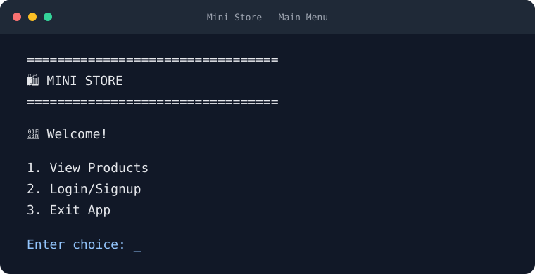
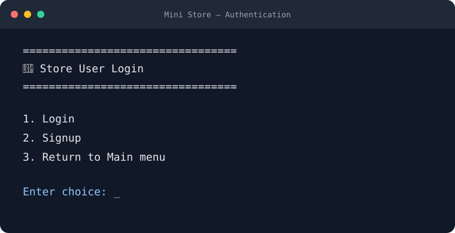
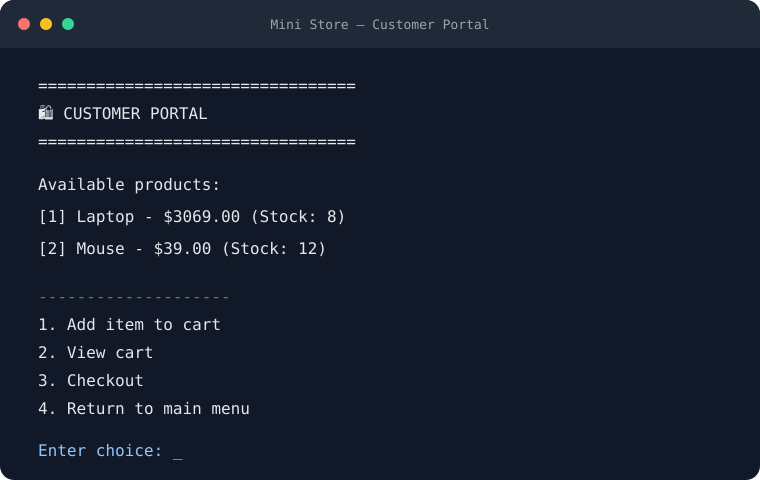
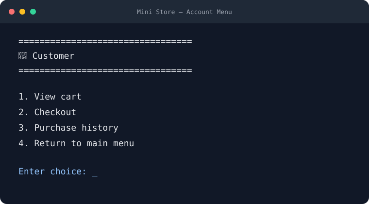
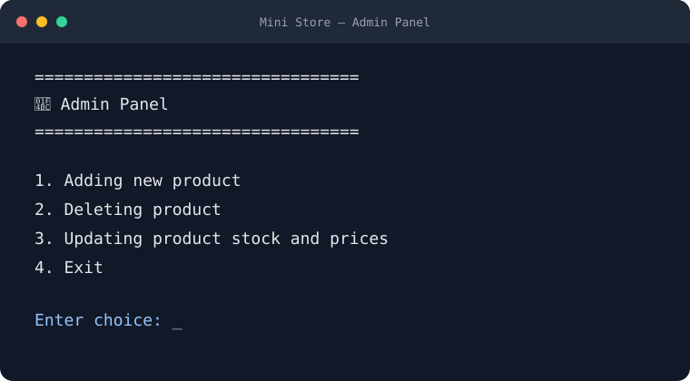

# Mini Store Management

A command-line store application for browsing products, managing a shopping cart,
creating an account, and maintaining a simple product catalog.

## Features

- Browse products and add items to a shopping cart
- Create an account, sign in, and review purchase history
- Update product prices and stock, or add and remove products
- Persist products and user data in local JSON files

## Requirements

- Python 3.12 or later
- No third-party Python packages are required

## Getting Started

Clone the repository and create the local data files from the provided examples:

```bash
git clone <repository-url>
cd mini_store_management
cp data/products.example.json data/products.json
cp data/users.example.json data/users.json
```

Run the application from the project root:

```bash
python app.py
```

Create an account through the app to get started. The sample user file is
intentionally empty.

## Administrator Access

On a fresh installation, create the first account with the exact username
`admin`. After signup, the application opens the Admin Panel for that account.
The panel can add products, delete products, and update product stock and prices.

Administrator access is currently determined by the username `admin`, not by
the order in which accounts are created. Only someone who can sign in as that
account can access the Admin Panel; other usernames use the regular account
menu. Keep the `admin` credentials private. This is a simple demonstration
application, not a production-ready authorization system.

## Menu Screenshots

The following screenshots show the main, authentication, customer, and
administrator menus:

| Main menu | Login and signup |
| --- | --- |
|  |  |

| Customer portal | Account menu |
| --- | --- |
|  |  |

| Admin Panel |
| --- |
|  |

## Data Files

The application reads and writes `data/products.json` and `data/users.json`.
These files are local and excluded from version control so that runtime changes
and user data are not committed. The `*.example.json` files are safe starter
templates tracked in the repository. Copy them again whenever you want to reset
your local data.

> **Note:** This project is intended for learning and demonstration. User
> passwords are stored as plain text in the local JSON file; do not use real
> credentials or deploy this application with sensitive data.
